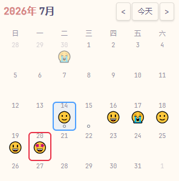
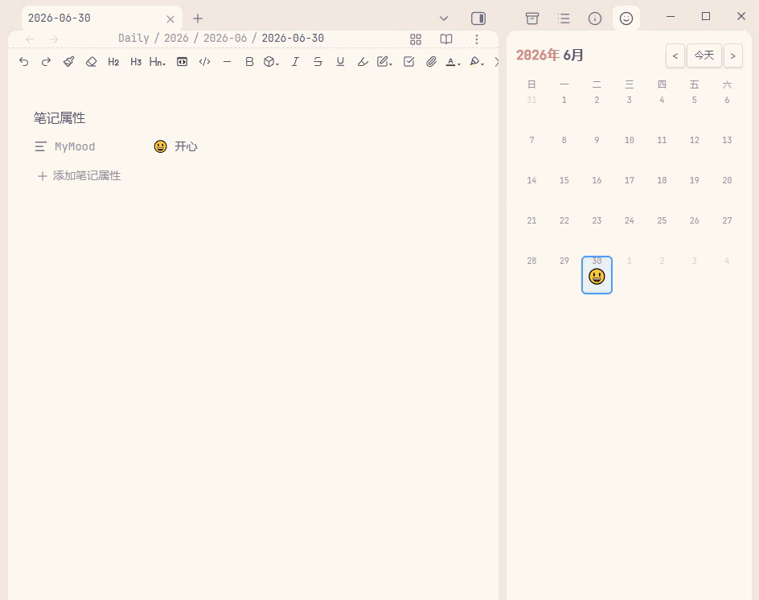
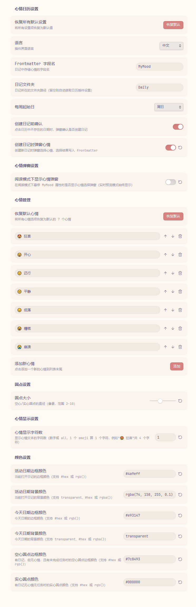

**中文** | [English](README.md)

<div align="center">
    <h1>🗓️ Mood Calendar · 心情日历</h1>
    
    
    
    
    <p>在 Obsidian 侧边栏放一本日历，每天的心情一眼可见。</p>
</div>

Mood Calendar 以日历视图展示你的日记，并在每个日期下方显示对应的心情 emoji。它读取日记 frontmatter 中的心情字段，配合点击日期即可创建日记并记录心情的流程，让"记日记 + 记心情"变成一件顺手的事。如果这个插件帮到了你，欢迎点个 ⭐ 支持一下～ 


## 效果预览







---

## ✨ 功能亮点

- **侧边栏日历**：启动时自动在右侧边栏打开，也可点击左侧笑脸图标随时唤出；支持 ` ```mood-calendar ` 代码块嵌入到任意笔记中。
- **心情可视化**：日期下方显示从日记 frontmatter 读取的心情 emoji，显示长度可调（单个 emoji 或完整文本）。
- **一键记录心情**：点击没有日记的日期 → 弹窗选择心情 → 自动创建日记并把心情写入 frontmatter，全程不用手动编辑属性。
- **悬停快速修改**：在编辑器中悬停 `MyMood` 属性值，弹出心情选择器，点一下即可改写当天心情。
- **日记状态一目了然**：
  - 😶 无标记 —— 该日期没有日记
  - ⚫ 实心圆点 —— 有日记，但没记心情、也没有待办
  - ⚪ 空心圆点 —— 有日记，且存在未完成任务 `- [ ]`
- **智能跟随**：切换活动文件时日历自动跳到对应月份并高亮当天；手动翻月后不会被打断。
- **深度兼容日记插件**：自动读取内置 Daily Notes 或 Periodic Notes 的日期格式、文件夹与模板，支持 `YYYY/MM/YYYY-MM-DD` 这类带目录的格式。
- **中英文双语**：界面语言可在设置中切换。

## 📦 安装

### 方式一：Obsidian 社区插件（推荐）

您可以从 Obsidian 设置中的社区插件下载。

### 方式二：手动安装

1. 前往 [Releases](https://github.com/GitHub-Xzhi/obsidian-mood-calendar/releases) 下载最新版本的 `main.js`、`manifest.json`、`styles.css`。
2. 在你的仓库中创建目录 `.obsidian/plugins/mood-calendar/`。
3. 将上述三个文件放入该目录。
4. 重启 Obsidian，在 **设置 → 第三方插件** 中启用 **Mood Calendar**。

## 🚀 使用

### 日历视图

插件启动后会自动在右侧边栏打开日历。点击日期：

- **该日期已有日记** → 直接打开。
- **该日期没有日记** → 弹出心情选择窗，选好后自动创建日记并将心情写入 frontmatter；点「跳过」则创建不带心情的日记。

> 也可以在设置里关闭创建前的心情弹窗，改回传统的确认弹窗或直接创建。

### 代码块嵌入

在任意笔记中插入：

````
```mood-calendar
```
````

即可在笔记内渲染当月日历。

### 悬停修改心情

在编辑区（实时预览模式，或开启相应设置后的阅读模式）把鼠标悬停到日记的 `MyMood` 属性值上，会弹出心情选择器，点击选项即可更新。

## ⚙️ 设置

| 设置项 | 说明 | 默认值 |
| --- | --- | --- |
| 语言 | 插件界面语言 | 中文 |
| Frontmatter 字段名 | 日记中存储心情的字段名 | `MyMood` |
| 日记文件夹 | 日记所在文件夹路径，留空则自动读取日历插件设置 | `Daily` |
| 每周起始日 | 每周从星期几开始 | 周一 |
| 创建日记前确认 | 点击不存在的日期时弹窗确认是否创建 | 开启 |
| 创建日记时弹窗心情 | 创建新日记时弹窗选择心情并写入 frontmatter | 开启 |
| 阅读模式下显示心情弹窗 | 阅读模式下悬停心情属性时是否弹出选择器 | 关闭 |
| 心情选项 | 自定义心情列表，支持增删、排序、恢复默认 | 7 个内置心情 |
| 圆点大小 | 状态圆点直径（像素，2–10） | 5 |
| 心情显示字符数 | 心情文本显示长度，数字或 `all` | 1 |
| 颜色设置 | 活动日期 / 今天 / 圆点的边框与背景颜色 | — |

## 🔧 兼容性说明

- **Templater**：创建日记时对 frontmatter 采用纯文本方式写入心情字段，不解析 YAML，因此模板中包含 `<% ... %>` 等 Templater 语法也不会报错。
- **Daily Notes / Periodic Notes**：自动识别两者的日期格式、文件夹与模板配置。
- **移动端**：`isDesktopOnly: false`，核心功能可在移动端使用。

## 🗂️ 项目结构

```
mood-calendar/
├── main.js        # 插件逻辑（纯 JS，无需编译）
├── manifest.json  # 插件清单
├── styles.css     # 样式
└── README.md
```

本插件为纯 JavaScript 编写，无需构建步骤，修改 `main.js` 后重新加载即可生效，欢迎直接阅读源码或提交 PR。

## 📄 许可证

[MIT](LICENSE) © [Xzhi](https://github.com/GitHub-Xzhi/)

## 💖支持

如果你喜欢这个插件，并对我表示感谢，你可以在这里请我喝一杯奶茶！

|             **微信**              |           **微信赞赏**           |              **支付宝**              |
| :-------------------------------: | :------------------------------: | :----------------------------------: |
|  |  |  |

