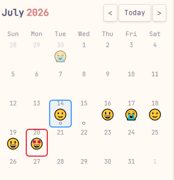
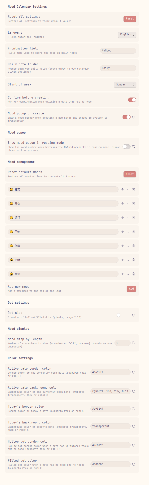

[中文](README-ZH.md) | **English**

<div align="center">
    <h1>🗓️ Mood Calendar</h1>
    
    
    
    
    <p>A calendar in your Obsidian sidebar — see every day's mood at a glance.</p>
</div>

Mood Calendar displays your daily notes in a calendar view, with a mood emoji shown beneath each date. It reads the mood field from your note's frontmatter and pairs it with a one-click workflow: tap a date, pick a mood, and the note is created for you. Journaling and mood tracking become one seamless gesture. If this plugin helps you, a ⭐ would mean a lot!


## Preview






---

## ✨ Features

- **Sidebar calendar**: Opens automatically in the right sidebar on startup; can also be summoned anytime via the smiley icon in the left ribbon. Supports embedding in any note with a ` ```mood-calendar ` code block.
- **Mood visualization**: Displays the mood emoji read from each note's frontmatter beneath the date. Display length is configurable (single emoji or full text).
- **One-click mood logging**: Click a date with no note → a mood picker pops up → the note is created with the chosen mood written to frontmatter. No manual property editing needed.
- **Hover to edit**: Hover over the `MyMood` property value in the editor and a mood picker appears — one click to update that day's mood.
- **Note status at a glance**:
  - 😶 No marker — no note exists for this date
  - ⚫ Filled dot — note exists but has no mood and no pending tasks
  - ⚪ Hollow dot — note exists with unfinished tasks `- [ ]`
- **Smart follow**: The calendar automatically jumps to the month of the active file and highlights today; manual month navigation won't be interrupted.
- **Deep daily-notes integration**: Automatically reads the date format, folder, and template from the built-in Daily Notes or Periodic Notes plugin. Supports directory-based formats like `YYYY/MM/YYYY-MM-DD`.
- **Bilingual UI**: Interface language can be switched in settings (English / 中文).

## 📦 Installation

### Option 1: Obsidian Community Plugin (Recommended)

Search for "Mood Calendar" in **Settings → Community plugins** inside Obsidian.

### Option 2: Manual Installation

1. Download the latest `main.js`, `manifest.json`, and `styles.css` from [Releases](https://github.com/GitHub-Xzhi/obsidian-mood-calendar/releases).
2. Create the directory `.obsidian/plugins/mood-calendar/` in your vault.
3. Place the three files into that directory.
4. Restart Obsidian and enable **Mood Calendar** under **Settings → Community plugins**.

## 🚀 Usage

### Calendar View

The calendar opens automatically in the right sidebar when the plugin loads. Click a date:

- **Note exists** → opens it directly.
- **No note** → a mood picker pops up; choose a mood and the note is created with the mood written to frontmatter. Click "Skip" to create a note without a mood.

> You can disable the mood popup on creation in settings, falling back to a traditional confirm dialog or immediate creation.

### Code Block Embed

Insert the following in any note:

````
```mood-calendar
```
````

This renders the current month's calendar inline.

### Hover to Edit Mood

In the editor (Live Preview mode, or Reading mode if the corresponding setting is enabled), hover over the `MyMood` property value in a daily note. A mood picker appears — click an option to update.

## ⚙️ Settings

| Setting | Description | Default |
| --- | --- | --- |
| Language | Plugin UI language | 中文 |
| Frontmatter field name | Field name used to store the mood in daily notes | `MyMood` |
| Daily notes folder | Folder path for daily notes; leave empty to auto-detect from calendar plugin settings | `Daily` |
| Week starts on | First day of the week | Monday |
| Confirm before creating | Show a confirmation dialog when clicking a date with no note | On |
| Mood popup on creation | Show a mood picker when creating a new note and write the choice to frontmatter | On |
| Mood popup in Reading mode | Show the mood picker when hovering the mood property in Reading mode | Off |
| Mood options | Customize the mood list — add, remove, reorder, or restore defaults | 7 built-in moods |
| Dot size | Status dot diameter in pixels (2–10) | 5 |
| Mood display length | Number of characters to show for mood text, or `all` | 1 |
| Colors | Border and background colors for active date / today / dots | — |

## 🔧 Compatibility

- **Templater**: The mood field is written to frontmatter as plain text without parsing YAML, so templates containing `<% ... %>` Templater syntax won't cause errors.
- **Daily Notes / Periodic Notes**: Automatically detects date format, folder, and template configuration from either plugin.
- **Mobile**: `isDesktopOnly: false` — core features work on mobile.

## 🗂️ Project Structure

```
mood-calendar/
├── main.js        # Plugin logic (plain JS, no build step required)
├── manifest.json  # Plugin manifest
├── styles.css     # Styles
└── README.md
```

This plugin is written in plain JavaScript with no build step. Edit `main.js`, reload, and changes take effect immediately. Feel free to read the source or submit a PR.

## 📄 License

[MIT](LICENSE) © [Xzhi](https://github.com/GitHub-Xzhi/)

## 💖 Support

If you enjoy this plugin and want to say thanks, you can buy me a bubble tea!

|             **WeChat Pay**              |           **WeChat Tip**           |              **Alipay**              |
| :-------------------------------: | :------------------------------: | :----------------------------------: |
|  |  |  |
